

 

# Hi 👋, I'm Amr Salem

### Senior Software QA Automation Engineer · QA Lead · QA Principal

I specialize in **Test Automation, Performance Testing, API Testing, Mobile Testing, and CI/CD Integration**.

I have experience working in diverse international environments and across the complete software development lifecycle — from defining test strategies and test plans to building scalable automation solutions for **Web, Mobile, APIs, and distributed systems**.

 

<a href="https://amr-salem.com"><kbd>🌐 Portfolio</kbd></a>
&nbsp;&nbsp;
<a href="https://www.linkedin.com/in/amrsalem1/"><kbd>💼 LinkedIn</kbd></a>
&nbsp;&nbsp;
<a href="https://medium.com/@Amr.sa"><kbd>✍️ Medium</kbd></a>
&nbsp;&nbsp;
<a href="mailto:akamel.salim@gmail.com"><kbd>📧 Email</kbd></a>

  

📫 **Contact**

<a href="mailto:akamel.salim@gmail.com">akamel.salim@gmail.com</a>

  

💬 **Focus**

Testing · Automation · Performance · API · Mobile · CI/CD

---

## 📊 GitHub Stats

---

## 📕 Latest Blog Posts

<a href="https://medium.com/@Amr.sa/astur-mobile-automation-cant-get-any-easier-61b3d648cf3d">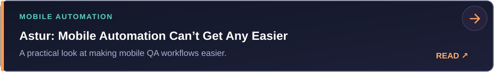</a>

<a href="https://medium.com/@Amr.sa/healwright-let-your-playwright-tests-heal-their-own-selectors-on-the-fly-d0178568f9bc">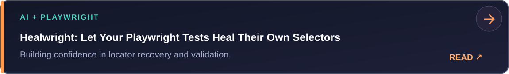</a>

<a href="https://medium.com/@Amr.sa/when-code-gets-repackaged-with-an-ai-facelift-6b027330f0ff">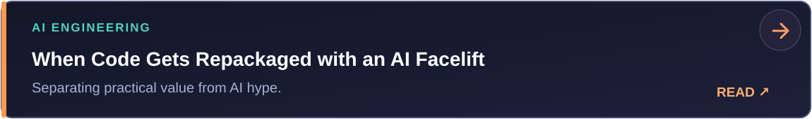</a>

 

<a href="https://medium.com/@Amr.sa"><kbd>✍️ Read More on Medium</kbd></a>

---

## 🚀 Open Source Projects

<a href="https://github.com/amrsa1/healwright">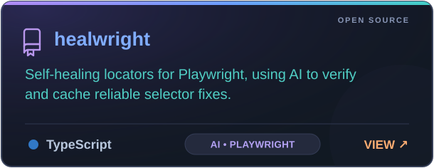</a>&nbsp;<a href="https://github.com/amrsa1/multimodal-hybrid-rag">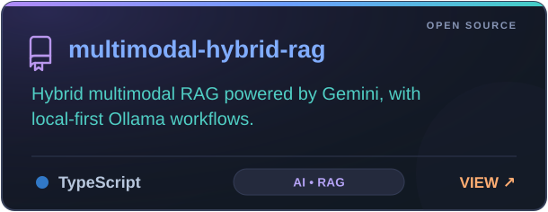</a>

<a href="https://github.com/amrsa1/swagger-mcp">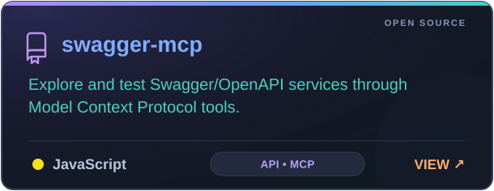</a>&nbsp;<a href="https://github.com/amrsa1/Android-Emulator-image">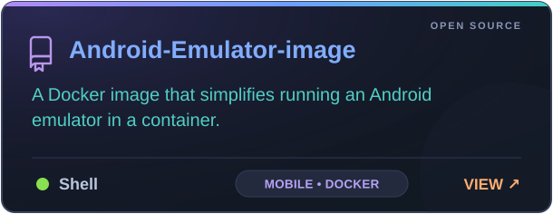</a>

<a href="https://github.com/amrsa1/playwright-android">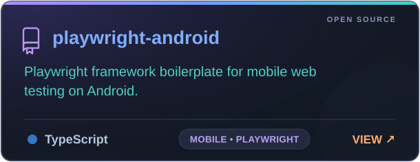</a>&nbsp;<a href="https://github.com/amrsa1/android-emulator-workflow">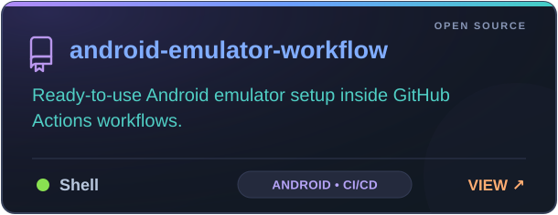</a>

<a href="https://github.com/amrsa1/GPT-unitTest">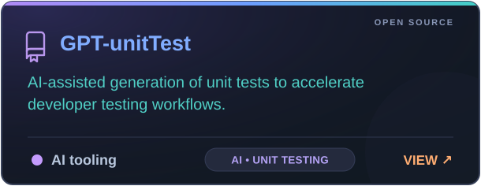</a>&nbsp;<a href="https://github.com/amrsa1/wdio-nativeApp">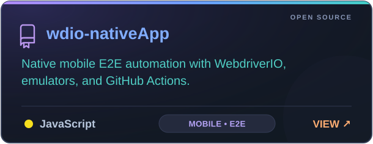</a>

<a href="https://github.com/amrsa1/wdio-xplatform-mobile-app">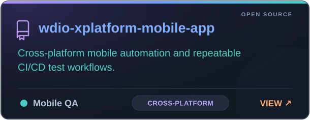</a>&nbsp;<a href="https://github.com/amrsa1/desktopAppAutomationTest">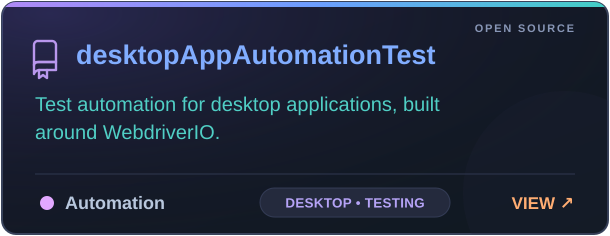</a>

<a href="https://github.com/amrsa1/playwright-APITesting">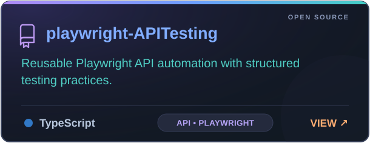</a>&nbsp;<a href="https://github.com/amrsa1/UniParser">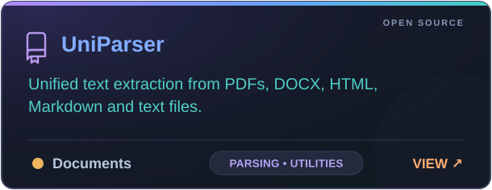</a>

---

## 🧰 Tech & QA Focus

**Test Automation**  
Playwright · WebdriverIO · Selenium · Appium

**API & Backend Testing**  
REST APIs · Swagger/OpenAPI · API Automation · Contract Testing

**Mobile Testing**  
Android · Native Apps · Cross-Platform Automation · Emulator Automation

**Performance Engineering**  
Load Testing · Performance Testing · Scalability Testing

**CI/CD & DevOps**  
GitHub Actions · CI/CD Pipelines · Docker · Automated Quality Gates

**AI & Modern QA**  
AI-Assisted Testing · RAG · MCP · Automated Test Generation

---

## 💡 Areas of Interest

🤖 AI-Assisted Software Testing  
📱 Mobile Automation  
⚡ Performance Engineering  
🔌 API Automation  
🧪 Quality Engineering  
🚀 CI/CD & DevOps  
🧠 LLM & RAG Applications

---

## 🤝 Let's Connect

Interested in **QA Automation, AI-assisted Testing, Mobile Automation, Performance Engineering, API Testing, or CI/CD?**

 

<a href="https://www.linkedin.com/in/amrsalem1/"><kbd>💼 LinkedIn</kbd></a>
&nbsp;&nbsp;
<a href="https://medium.com/@Amr.sa"><kbd>✍️ Medium</kbd></a>
&nbsp;&nbsp;
<a href="https://amr-salem.com"><kbd>🌐 Portfolio</kbd></a>
&nbsp;&nbsp;
<a href="mailto:akamel.salim@gmail.com"><kbd>📧 Email</kbd></a>

  

**Building better software through better quality engineering.**

